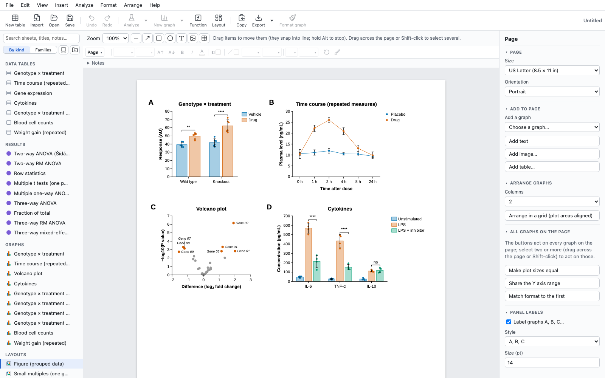

# statPlotter

statPlotter is a free, open-source analysis and graphing app for lab data. You enter or import
your data into typed tables, run statistics that are checked against R, and draw
publication-quality graphs and figure pages from them. Everything stays linked: change a value
and every analysis, graph and figure that uses it updates.

It runs in the browser and as a desktop app (macOS and Windows) from one TypeScript codebase.



**Try it:** <https://statplotter.netlify.app> (nothing to install; your data never leaves your
computer, see [Privacy](#privacy)).

## Features

- **Data tables** for the common lab layouts: XY, column, grouped, contingency, survival, parts of
  whole, nested, and multiple variables (numbers, text and calculated columns). Enter replicates
  or mean with SD/SEM and N, exclude values, sort, fill series (such as dilutions), find and
  replace. Import CSV, Excel and `.pzfx` files.
- **Statistics:** t tests and nonparametric tests; one-, two- and three-way and repeated-measures
  ANOVA, mixed models and multiple comparisons; linear, multiple, logistic, Poisson and Cox
  regression; nonlinear curve fitting (over a hundred built-in equations, your own equations,
  differential equations); survival, contingency, normality, PCA, ROC, power analysis and
  simulations; data transforms.
- **Graphs:** bars, points, box and violin plots, XY and time courses, survival curves, heat maps,
  volcano plots, histograms, pie and donut charts and many combinations, built from layers in a
  graph builder. Format anything by double-clicking it; significance brackets come straight from
  the analyses.
- **Figures:** lay out graphs, text, shapes, images and live tables on pages, with snapping,
  alignment and panel labels.
- **Export:** vector PDF (fonts embedded, text selectable) and SVG, or PNG, TIFF and JPEG at up
  to 2400 dpi, at a journal's column width; print at actual size; copy graphs as vector graphics
  into Word, PowerPoint or Illustrator. Tables and results export to CSV, TSV and Excel.
- **Reuse:** templates, saved methods (analyses and graphs without data) and graph presets, and
  "apply to other data" for repeated experiments.
- **Safety:** unsaved work is kept as a recovery copy and offered back after a crash or a closed
  tab; the desktop app saves atomically and keeps the previous version.
- **Examples:** File › Examples opens example projects for each area, including figures rebuilt
  from published papers' open source data.

What's covered, area by area: [docs/FEATURE_COVERAGE.md](docs/FEATURE_COVERAGE.md).

## How the statistics are checked

Every statistic is tested against reference results computed independently:

- **R:** for each method, R scripts (in `tools/oracle`, with pinned package versions) compute the
  expected results for a set of cases, which are committed as fixtures. The tests compare
  statPlotter's results with them, typically to a relative tolerance of about 10⁻¹⁰.
- **NIST:** the U.S. National Institute of Standards and Technology's Statistical Reference
  Datasets (StRD) check the numerical accuracy of summary statistics, linear regression and
  nonlinear fitting against certified values, including the deliberately hard cases.

The fixtures are in the repository, so running the tests needs neither R nor network access.

## Building and running

You need [Node.js](https://nodejs.org) 24 and [pnpm](https://pnpm.io) (`corepack enable` sets up
the version the repository names).

```bash
pnpm install
pnpm dev
```

The web app is then at <http://localhost:5173>.

```bash
pnpm --filter @ps/web build
```

writes the production web build (static files) to `apps/web/dist`.

### Desktop app

The desktop app uses [Tauri](https://tauri.app) and also needs Rust (stable) and, on macOS, the
Xcode command-line tools (on Windows, the prerequisites in Tauri's guide).

```bash
pnpm desktop
```

The first build compiles the Rust side and takes a few minutes.

### Tests

```bash
pnpm check
```

runs the package dependency rules, the linter and formatter (Biome), the TypeScript compiler and
every unit test (a few minutes).

```bash
pnpm --filter @ps/e2e exec playwright install   # once
pnpm e2e
```

runs the end-to-end tests of the production build in Chromium, WebKit and Firefox. Add
`--project=chromium` or a spec file to run fewer.

Regenerating the reference results needs R (`pnpm oracle`, an renv project in `tools/oracle`) or
network access (`pnpm nist`).

## Privacy

**Privacy.** statPlotter runs entirely in your browser. Your data, files and graphs stay on your
computer: nothing is uploaded to a server, there is no account, and no tracking or analytics. The
app is also technically blocked from sending anything to any other site (its security policy
allows connections only to its own address). Unsaved work is kept as a recovery copy in this
browser's storage on your device. On a shared computer, use a private window or clear the site's
data when you're done.

The desktop app works the same way, with its recovery copies in its own folder on your computer.
If a release is set up for updates, it asks the project's release page at most once a day whether
a newer version exists, sending nothing about your work; you can turn that off in Preferences.

## Code

A pnpm monorepo of TypeScript packages, consumed as source:

| Package | Contents |
|---|---|
| `packages/model` | document schema, table kinds, formula language |
| `packages/engine` | commands, undo/redo, recalculation |
| `packages/stats` | statistics and numerics (no dependencies) |
| `packages/analyses` | one plugin per analysis |
| `packages/graph` | graph layout, drawing and export (SVG, PDF, images) |
| `packages/io` | import, export and the project file |
| `packages/ui` | the React interface |
| `apps/web`, `apps/desktop` | browser and desktop (Tauri) entry points |
| `apps/e2e` | end-to-end tests (Playwright) |

Design: [docs/ARCHITECTURE.md](docs/ARCHITECTURE.md). Document schema, file format and results:
[docs/DATA_MODEL.md](docs/DATA_MODEL.md). History and plans: [docs/ROADMAP.md](docs/ROADMAP.md).

Contributions are welcome: see [CONTRIBUTING.md](CONTRIBUTING.md). To report a security problem,
see [SECURITY.md](SECURITY.md).

## Licence

statPlotter is free software under the GNU General Public License, version 3 or later
(GPL-3.0-or-later): see [LICENSE](LICENSE). Copyright (C) 2026 Shihan Li.

Some numerical routines are translated from R and R packages (GPL-2-or-later, GPL-2 | 3,
LGPL-2-or-later); they are kept in `packages/stats/src/gpl/`, each citing its source. The bundled
Liberation fonts keep their own licences (SIL Open Font License 1.1; GPL-2 with the font
exception for Liberation Sans Narrow). Some built-in examples include published source data under
CC BY 4.0. [NOTICE](NOTICE) lists all of these and the third-party test data.
